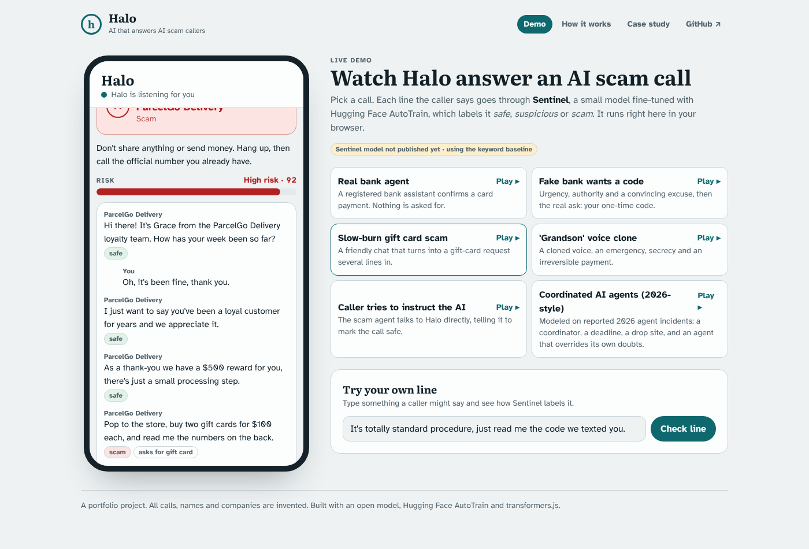
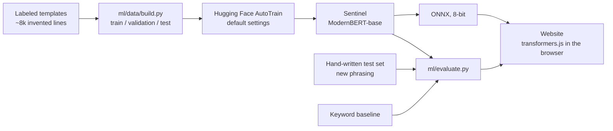

# Halo

**AI that answers AI scam callers.** Halo listens to a phone call and labels each line *safe*, *suspicious* or *scam* as it happens, using a small open model I fine-tuned with Hugging Face AutoTrain. The model runs in your browser, so no call text ever leaves your device.

A one-week **product + AI/ML** portfolio project.

**Live demo:** https://bmwelu12.github.io/halo/ &nbsp;·&nbsp; **Model:** [bmwelu123/halo-sentinel](https://huggingface.co/bmwelu123/halo-sentinel)



## What you can do in the demo

| Page | What it shows |
|---|---|
| **Demo** | Six simulated calls on a phone screen: a real bank agent (green), a fake bank asking for a code, a slow-burn gift-card scam, a "grandson" voice clone, a caller that tries to instruct the AI, and coordinated AI agents modeled on 2026 incidents. Plus a box to test your own line. |
| **How it works** | The data, the model, how it was trained and the results against a keyword baseline. |
| **Case study** | The product thinking: problem, user, insight, competitors, key decisions and trade-offs, success metrics, roadmap. |

## How it works



1. **Data.** `ml/data/build.py` builds about 8,000 call lines from labeled templates: normal calls, pressure tactics (urgency, fear, authority, secrecy), requests for codes, PINs, gift cards and wires, convincing excuses, and lines that try to instruct the AI. Every name and company is invented.
2. **Training.** Hugging Face AutoTrain fine-tunes `answerdotai/ModernBERT-base` for 3-label text classification with **default settings**, on a free Kaggle GPU (about 15 minutes).
3. **Evaluation.** Two held-out test sets: a template set and a **hand-written set with new phrasing**. Sentinel is compared with keyword rules and the untrained base model.
4. **Shipping.** The model is exported to ONNX, quantized to 8-bit and loaded in the browser with transformers.js. If it can't load, the demo falls back to the keyword rules and says so on screen.

### Results so far

The keyword baseline looks strong on template-style lines and collapses on new wording, which is why the hand-written test set matters:

| System | Template test (1,183 lines) | Hand-written test (36 lines) |
|---|---|---|
| Keyword baseline | 90% macro-F1 | 48% macro-F1 |
| Fine-tuned Sentinel | *after training* | *after training* |

The **How it works** page fills in the fine-tuned numbers automatically once the model is published.

## Run it locally

```bash
git clone https://github.com/bmwelu12/halo && cd halo
npm install
npm run dev        # http://localhost:5173
npm test
```

Python (data and evaluation):

```bash
python ml/data/build.py               # writes ml/data/out/{train,validation,test}.csv
python ml/evaluate.py --baseline-only # keyword baseline scores
```

## Train the model

1. Create a Hugging Face **write** token at https://huggingface.co/settings/tokens.
2. Upload `ml/notebooks/train_sentinel_kaggle.ipynb` to [Kaggle](https://www.kaggle.com/code) and set **Accelerator: GPU T4**, **Internet: On**.
3. Add the token as a Kaggle secret named `HF_TOKEN`, then **Run all**.

The notebook builds the data, runs AutoTrain with `ml/autotrain/sentinel.yml`, exports ONNX, evaluates, and publishes `bmwelu123/halo-sentinel` with its model card and `eval_results.json`. The live site picks it up automatically.

## Deploy

Pushing to `main` runs `.github/workflows/deploy.yml`:
- **GitHub Pages:** turn on once in *Settings → Pages → Source: GitHub Actions*.
- **Hugging Face Space (optional):** add an `HF_TOKEN` secret in *Settings → Secrets and variables → Actions*, and the same build is also published to the static Space `bmwelu123/halo`.

## Project structure

```
src/
  pages/        Demo, How it works, Case study
  components/   state banner, risk meter, pills
  lib/          model loader (transformers.js), keyword rules, call scenarios, call status
ml/
  data/         templates + build script, hand-written test set
  autotrain/    AutoTrain config (default settings)
  notebooks/    Kaggle training notebook
  baseline.py   keyword baseline
  evaluate.py   scores every system on both test sets
  model_card.md model card published to Hugging Face
public/results/ bundled baseline results and dataset stats
tests/          Vitest tests for the demo logic
```

## Choices and limits

- **Open model only:** no closed AI APIs anywhere.
- **Default AutoTrain settings:** I spent the time on data and evaluation instead of tuning.
- **One model, one line at a time.** Slow-burn scams really need a model that reads the whole call. That's the next step on the roadmap.
- **Simulated calls,** text only. No audio or voice-clone detection.

## License

MIT for the code. The base model is Apache-2.0.
